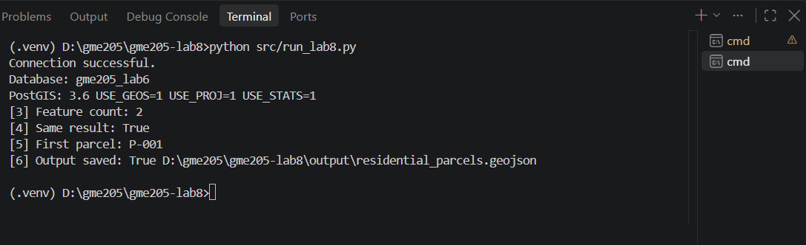
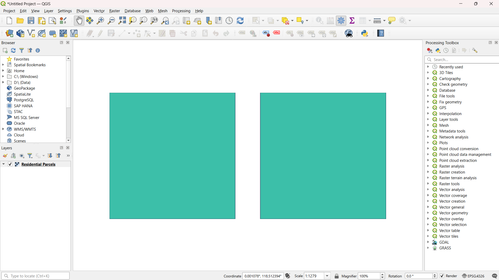
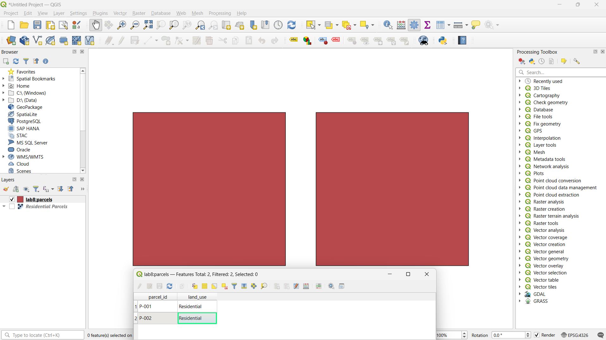
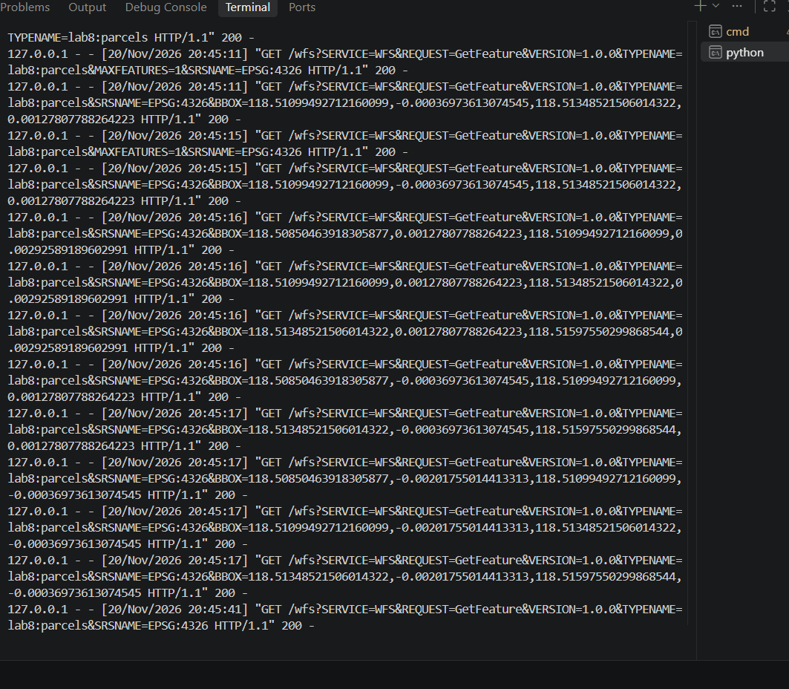

# GmE 205 Laboratory 8 — Reproducible Geoprocessing, Flask Services, and QGIS WMS/WFS Clients

The main objective of this laboratory activity is to reuse the existing Python, PostgreSQL/PostGIS, and GeoJSON components from the previous laboratory exercises to develop a reusable object-oriented geoprocessing pipeline. This involves automating the retrieval of parcel records, converting database rows into Python objects, generating and validating a GeoJSON FeatureCollection, and verifying the repeatability of the generated output. The pipeline is also integrated into a local Flask service to deliver spatial data through HTTP endpoints, Web Map Service (WMS), and Web Feature Service (WFS), which are accessed and visualized using QGIS.

### Objectives

The objectives of this laboratory are to:

- Reuse the existing database, spatial, and exchange modules from the previous laboratory exercise.
- Develop a reusable `ParcelPipeline` class using Object-Oriented Programming (OOP).
- Automate the retrieval, reconstruction, conversion, and validation of spatial data.
- Verify the repeatability of the generated GeoJSON output by comparing two pipeline executions.
- Develop a local Flask service that delivers spatial data through parameterized HTTP GET requests.
- Implement WMS and WFS endpoints using the instructor-provided OGC helper modules.
- Connect QGIS to the WMS and WFS services to visualize and inspect spatial data.
- Differentiate the rendered raster map provided by WMS from the vector features and attributes provided by WFS.

### Tools and Technologies

The following tools were used:

- **PostgreSQL 18**
- **PostGIS 3.6.2**
- **pgAdmin 4**
- **Visual Studio Code**
- **Python 3.x**
- **psycopg 3**
- **python-dotenv**
- **Flask**
- **Matplotlib**
- **JSON / GeoJSON**
- **XML / GML**
- **Web Map Service (WMS 1.1.1)**
- **Web Feature Service (WFS 1.0.0)**
- **QGIS**
- **Web Browser**
- **Git**
- **GitHub**

### Database Information

- **Database Name:** `gme205_lab6`
- **Schema:** `lab6`
- **Table:** `parcels`
- **PostgreSQL Version:** 18
- **PostGIS Version:** 3.6.2
- **Source SRID:** 32651 (WGS 84 / UTM Zone 51N)
- **Output SRID:** 4326 (WGS 84)

### How to Set Up the Virtual Environment

1. Open the project folder (`gme205-lab8`) in VS Code.
2. Open the terminal (`Terminal -> New Terminal`) and create the virtual environment:

   ```bash
   python -m venv .venv
   ```

3. Activate the virtual environment:

   ```bash
   .venv\Scripts\activate
   ```

4. Confirm that the terminal prompt shows `(.venv)`.
5. Select the interpreter inside `.venv` using `Ctrl + Shift + P -> Python: Select Interpreter`.
6. Install the required Python libraries:

   ```bash
   pip install "psycopg[binary]" python-dotenv flask matplotlib
   ```

7. Generate the `requirements.txt` file:

   ```bash
   pip freeze > requirements.txt
   ```

### Database Configuration

1. Reuse the existing PostgreSQL/PostGIS database from the previous laboratory exercise.
2. Create a `.env` file in the project root.
3. Configure the database connection using the following environment variables:

   ```env
   DB_HOST=localhost
   DB_NAME=gme205_lab6
   DB_USER=postgres
   DB_PASSWORD=password
   DB_PORT=5432
   ```

4. Create a `.env.example` file containing the database configuration template without the actual password.
5. Exclude the `.env` file and `.venv` folder from the GitHub repository using `.gitignore`.
6. Open the existing database in pgAdmin 4 and verify the database connection and PostGIS version using:

   ```sql
   SELECT current_database(), PostGIS_Version();
   ```

7. Verify the existing parcel records using:

   ```sql
   SELECT parcel_id, land_use
   FROM lab6.parcels ORDER BY parcel_id;
   ```

### How to Run the Geoprocessing Pipeline

1. Open the project folder in VS Code and activate the virtual environment.
2. Execute the temporary pipeline check using:

   ```bash
   python -c "import sys; sys.path.insert(0, 'src'); from pipeline import ParcelPipeline; print(ParcelPipeline('Residential').run()['type'])"
   ```

3. Verify that the terminal displays `FeatureCollection`.
4. Execute the main Python program using:

   ```bash
   python src/run_lab8.py
   ```

5. Verify the database connection, feature count, equality of the two pipeline executions, first parcel ID, and output file path.
6. Open the generated GeoJSON file located at `output/residential_parcels.geojson`.

The expected results are two Residential parcel features, P-001 as the first parcel, and `Same result: True` when the input data remains unchanged.

### How to Run the Flask Service

1. Open the terminal in VS Code and activate the virtual environment.
2. Start the Flask application using:

   ```bash
   python src/app.py
   ```

3. Verify that the Flask server is running at `http://127.0.0.1:5000`.
4. Keep the Flask terminal running while accessing the services through the browser and QGIS.
5. Test the following HTTP endpoints:

| Request | URL | Expected Status |
|---|---|---|
| Health Check | `http://127.0.0.1:5000/health` | 200 |
| Residential Parcels | `http://127.0.0.1:5000/api/parcels?land_use=Residential` | 200 |
| Commercial Parcels | `http://127.0.0.1:5000/api/parcels?land_use=Commercial` | 200 |
| Unsupported Land Use | `http://127.0.0.1:5000/api/parcels?land_use=Unknown` | 400 |

The Residential request returns two parcel features, while the Commercial request returns one parcel feature. The unsupported land-use request returns an error message because the provided value is not included in the allowed land-use classifications.

### Service Discovery Checks

The following diagnostic URLs are used to verify the WMS and WFS services before connecting QGIS:

**WMS GetCapabilities**

    http://127.0.0.1:5000/wms?SERVICE=WMS&REQUEST=GetCapabilities

**WFS GetCapabilities**

    http://127.0.0.1:5000/wfs?SERVICE=WFS&REQUEST=GetCapabilities

**WMS GetMap**

    http://127.0.0.1:5000/wms?SERVICE=WMS&VERSION=1.1.1&REQUEST=GetMap&LAYERS=parcels&STYLES=&SRS=EPSG:4326&BBOX=118.5,0,118.505,0.005&WIDTH=600&HEIGHT=600&FORMAT=image/png

The GetCapabilities requests return XML documents containing information about the available services, layers, coordinate reference systems, and supported operations. The GetMap request returns a PNG image based on the specified bounding box.

### How to Connect QGIS to the WMS Service

1. Open QGIS while the Flask server is running.
2. Open the Data Source Manager and select `WMS/WMTS`.
3. Click `New` and enter the following connection details:

   - **Name:** GmE205 Lab8 WMS
   - **URL:** http://127.0.0.1:5000/wms

4. Click `OK` and select `Connect`.
5. Select the `Residential Parcels` layer.
6. Click `Add` and zoom to the layer.

The WMS service displays the two Residential parcels as rendered green polygons. Since the provided WMS layer is non-queryable, individual parcel attributes cannot be inspected directly.

### How to Connect QGIS to the WFS Service

1. Open the QGIS Data Source Manager and select `WFS / OGC API - Features`.
2. Click `New` and enter the following connection details:

   - **Name:** GmE205 Lab8 WFS
   - **URL:** http://127.0.0.1:5000/wfs

3. Click `OK` and select `Connect`.
4. Select the `lab8:parcels` feature type.
5. Click `Add` to display the vector layer.
6. Right-click the vector layer and select `Open Attribute Table`.

The WFS service displays the two Residential parcels as vector features. The attribute table contains the parcel IDs and their corresponding land-use classifications.

### Data Path

#### 1. What parts of the pipeline were reused from Laboratory 7–8 rather than rewritten?

The `database.py`, `spatial.py`, and `exchange.py` modules were reused to retrieve parcel records, convert them into `Parcel` objects, and generate a validated GeoJSON FeatureCollection. The existing PostgreSQL/PostGIS database from Laboratory 6 was also reused.

#### 2. Why is ParcelPipeline a useful coordinating object? What should it NOT do?

`ParcelPipeline` coordinates database retrieval, object reconstruction, GeoJSON generation, and validation in one reusable workflow. It should not handle database credentials, SQL queries, Flask routes, file paths, or map rendering because these belong to separate modules.

#### 3. Why must we specify stable query ordering when comparing outputs?

Stable ordering ensures that records appear in the same sequence during repeated executions. Using `ORDER BY parcel_id` prevents differences in feature order from affecting the comparison results.

#### 4. What is the difference between a saved .geojson file and the Flask endpoint?

A saved `.geojson` file stores the generated spatial data locally, while the Flask endpoint delivers GeoJSON through HTTP requests and allows users to retrieve parcels based on their land-use classification.

#### 5. How do the temporary prints and HTTP responses help locate a failed boundary?

Temporary prints verify the database connection, feature count, output equality, and file generation. HTTP status codes help identify successful requests (200), invalid inputs (400), database unavailability (503), and data-processing errors (500).

#### 6. Compare WMS and WFS in QGIS: what can you inspect in the vector attribute table that you cannot inspect in the rendered WMS image?

WMS displays the parcels as rendered raster images, while WFS provides vector features with inspectable attributes. The WFS attribute table shows parcel IDs P-001 and P-002 and their Residential land-use classifications, which cannot be inspected directly in the non-queryable WMS image.

### WMS and WFS Reflection

WMS and WFS use the same spatial data generated by `ParcelPipeline` but provide different outputs. WMS delivers rendered PNG maps through GetCapabilities and GetMap, while WFS delivers vector features through GetCapabilities, DescribeFeatureType, and GetFeature.

The provided services are simplified classroom implementations of WMS 1.1.1 and WFS 1.0.0, not OGC-certified servers. The WFS service does not support write transactions, and the parcel geometries are synthetic data used for demonstrating geoprocessing and interoperability.

### Laboratory Outputs

**Figure 1. Console Output of the Reproducible Geoprocessing Pipeline**



**Figure 2. Residential Parcels Loaded in QGIS through WMS**



**Figure 3. Residential Parcels and Attribute Table Loaded in QGIS through WFS**



**Figure 4. Flask Terminal Showing HTTP Requests**


